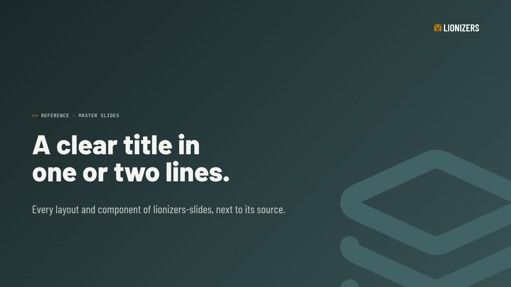
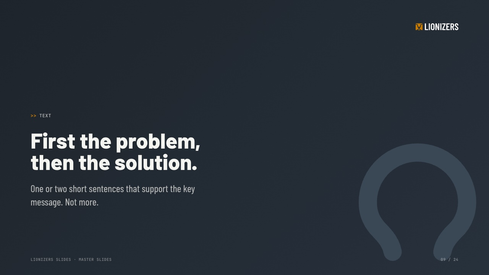
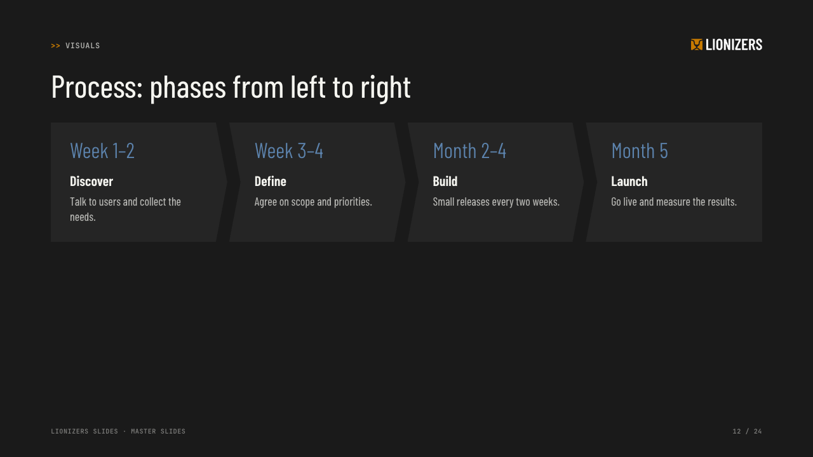
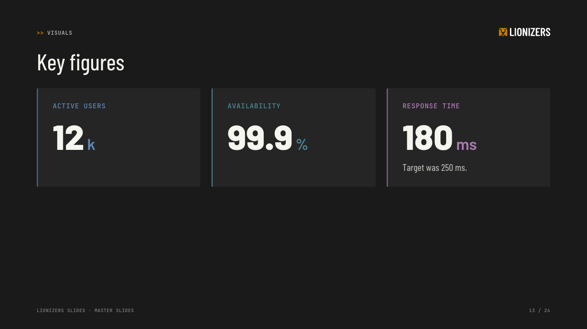
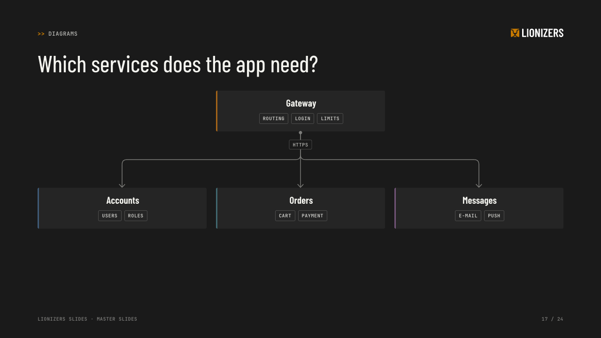
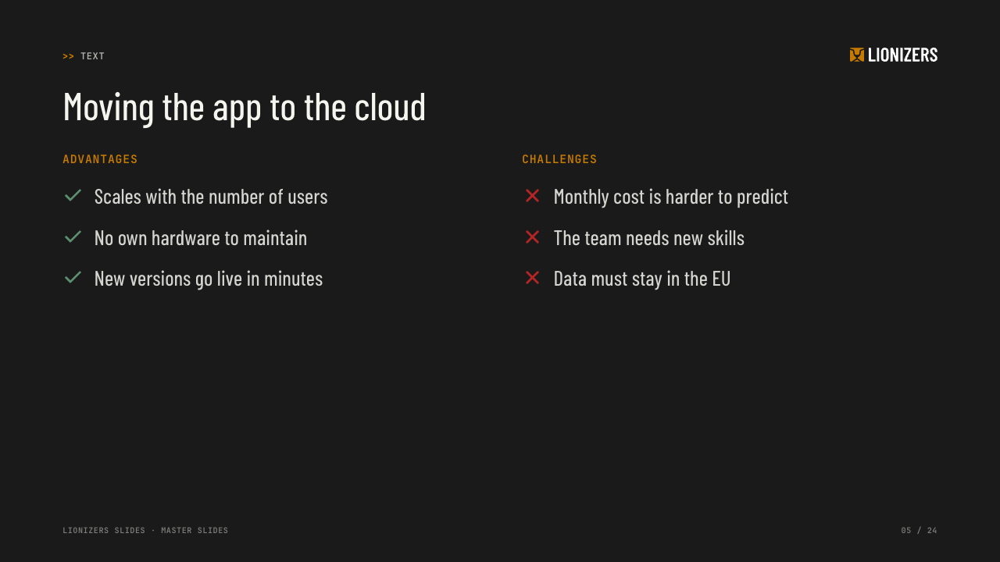
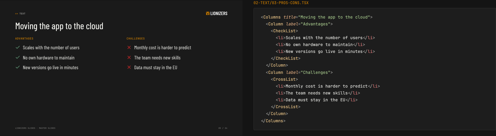
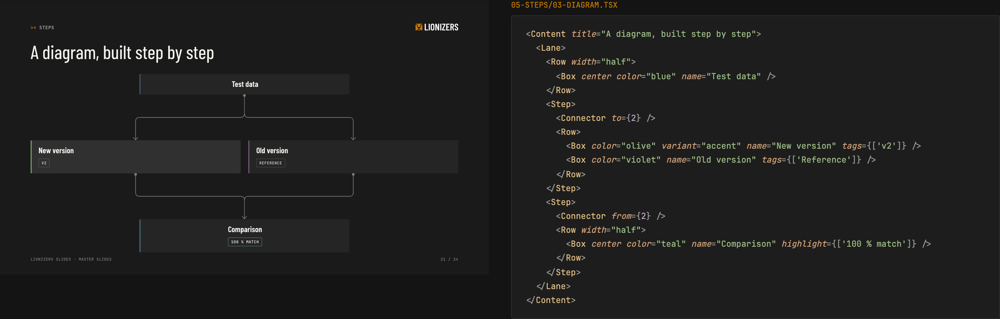

# Lionizers Slides

Presentations in the Lionizers CI, written as code: one short file per slide.

<table>
  <tr>
    <td></td>
    <td></td>
  </tr>
  <tr>
    <td></td>
    <td></td>
  </tr>
  <tr>
    <td></td>
    <td></td>
  </tr>
</table>

**Try it:** [open the example deck](https://lionizers.github.io/slides/) and use the arrow keys.
Press `O` for the overview and `P` for the presenter view.

## Features

- **Built-in CI.** You focus on the content.
- **One file per slide.** Folders are chapters.
- **Ready-made layouts and components** for all common use cases.
- **Animations and transitions.** Opt in to build-ups and morphs between slides.
- **Presenter view** with speaker notes and timer, in a second window.
- **Overview** of all slides, fullscreen, keyboard navigation.
- **Live reload.** Every save shows immediately in the browser.
- **Export** to PDF or one self-contained HTML file.

## How slides are written

[](https://lionizers.github.io/slides/?source)

The [source view](https://lionizers.github.io/slides/?source) shows every slide of the example deck
next to its code. It is the best place to learn the layouts and components, and to copy from.
In your own deck, press `S` to open it.

The outer element selects the layout, here `<Columns>` with two `<Column>`s. Inside, you use
components such as `<CheckList>`, and normal text elements such as `<p>`, `<ul>`, `<strong>` or
`<table>`. You do not need class names or CSS: the layout gives every element its style.
No imports, no configuration. Your editor knows all components and props and shows errors as you
type.

Diagrams are components too. Wrap parts in `<Step>`, and they appear click by click:

[](https://lionizers.github.io/slides/?source#slide-21)

Speaker notes go into `<Notes>` at the end of a slide.

A deck is a folder:

```
my-talk/
  00-title.tsx            slides, sorted by name
  01-agenda.tsx
  02-goals/               folder = chapter
    01-what-we-want.tsx
  99-end.tsx
  _deck.tsx               deck settings (title, language)
  img/                    images
  .lionizers/components/  the design: layouts, components, theme, fonts, logos
```

## Start a deck

You need Node.js 20 or newer.

```sh
npx github:lionizers/slides init my-talk   # new deck with sample slides
cd my-talk
npx github:lionizers/slides                # opens the deck in the browser, reloads on every change
```

Press `S` in the browser to see every slide next to its code. To learn the layouts and
components, look at the [example deck in the source view](https://lionizers.github.io/slides/?source)
and copy what you need.

To type less, install the tool once. To update, run the same command again.

```sh
npm install -g --install-links github:lionizers/slides
lionizers-slides init my-talk
```

## Present and share

| Key             | Does                                      |
| --------------- | ----------------------------------------- |
| `→` `←` `Space` | next / previous step or slide             |
| `↓` `↑`         | next / previous slide, without steps      |
| `O`             | overview of all slides                    |
| `P`             | presenter view in a second window         |
| `S`             | source view: every slide next to its code |
| `F`             | fullscreen                                |
| `H` `?`         | help                                      |

Without the global install, write `npx github:lionizers/slides` instead of `lionizers-slides`.

| Command                                          | Does                                                                                |
| ------------------------------------------------ | ----------------------------------------------------------------------------------- |
| `lionizers-slides [dir]`                         | Dev server with live reload                                                         |
| `lionizers-slides init [dir]`                    | New deck with sample slides and the design                                          |
| `lionizers-slides check [dir]`                   | Type-check and render all slides, find content that does not fit                    |
| `lionizers-slides html [dir] [-o file]`          | One HTML file with everything inside. Opens without a server or internet connection |
| `lionizers-slides pdf [dir] [-o file] [--steps]` | PDF, one page per slide or per step. Uses the installed Google Chrome               |
| `lionizers-slides build [dir] [-o dir]`          | Static website, for example for GitHub Pages                                        |
| `lionizers-slides guide`                         | Print the guide for coding agents (`AGENTS.md`)                                     |

Options: `-p <port>` (default 4747), `--no-open`.

## Why not Marp or open-slide?

[Marp](https://marp.app) makes slides from Markdown. Markdown is good for text, but our slides have
more structure: columns, processes, key figures, diagrams. In Markdown, these become HTML with class
names or special syntax. Here, each of them is a component with a name and with props that the
editor checks.

[open-slide](https://github.com/open-slide/open-slide) goes the other way: each slide is a free React
component on an empty canvas. Everything is possible, also slides that do not follow the corporate
design. Whoever writes the slide, a person or a coding agent, has to design it again each time.

Lionizers Slides is in the middle. A fixed set of layouts and components makes sure that every slide
follows the corporate design. When a slide needs something special, free HTML with Tailwind is
still possible, but only with the colours and fonts of the design.

## How versions work

**The design is part of the deck.** `init` copies the current components into `.lionizers/components/`.
From then on, the deck owns them. New design versions only go into new decks. A deck can also
change or extend its copy: every export of the components folder is available in all slides.

**The tool is not pinned.** A deck always runs with the installed version of the tool, and changes
to the tool stay compatible. As a fallback, `.lionizers/built-with` records the commit of the tool
that the deck last worked with. If the installed tool is a different commit, the dev server and a
failing `check` show the command for the old version: `npx github:lionizers/slides#<commit>`.

## Develop this package

```sh
npm install
npm run dev     # the example deck in examples/
npm run check
```

There are no version numbers and no tags. Every push to `main` is the new version, named by its
commit hash. An install has no `.git` folder, so the tool finds its hash in another place: npm
usually downloads the GitHub tarball, and `git archive` writes the hash into `.archive-commit`
(see `.gitattributes`). When npm clones the repository instead, `scripts/prepare.js` writes it
into `.commit`. As a last fallback, the tool reads it from the lockfile of the install.
A push to `main` also publishes the example deck to GitHub Pages
(`.github/workflows/pages.yml`).

How it works:

- **Vite plugin** (`src/plugin.js`): finds the slide files and wraps the JSX of each slide into a
  module (imports for all exports of the components + a default export, all in the first line so
  that line numbers stay right). It turns relative `src="img/x.png"` into imports, and plain text
  in `<Notes>` into a string so that line breaks survive.
- **Types**: the plugin writes `.lionizers/types/globals.d.ts` and a tsconfig. Editors and `tsc`
  then know every component and prop without imports.
- **Runtime** (`app/`): Preact. Viewer, overview, presenter view (BroadcastChannel sync), print view
  for the PDF (Playwright + installed Chrome), source view. A slide is always 1280 × 720 and scaled.
- **Styling**: `.lionizers/components/theme.css` contains the design as CSS. For special cases,
  Tailwind v4 is available with a theme that has only the design colours and fonts.
- **One HTML file** (`html`): a normal Vite build with all assets inlined as data URLs, then the
  script and the stylesheet go into `index.html`.
- **Agent guide**: `init` also puts an `AGENTS.md` (and a `CLAUDE.md` that points to it) into the
  deck. It describes the layouts, components and rules for coding agents that help with the code.
